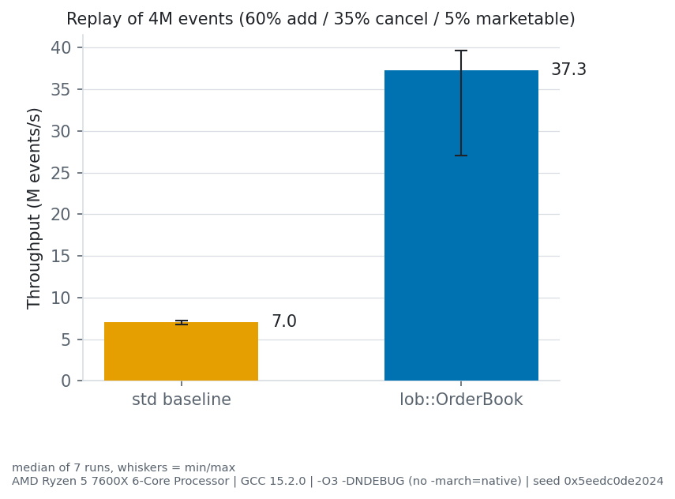
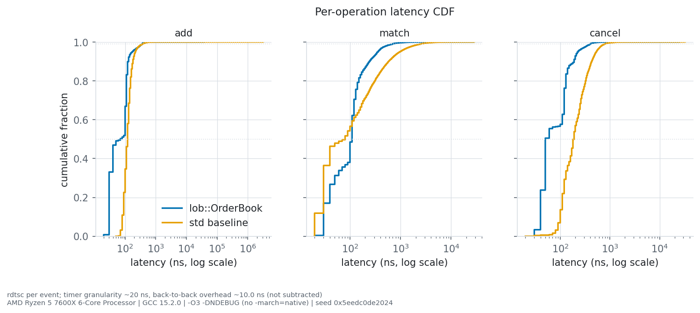
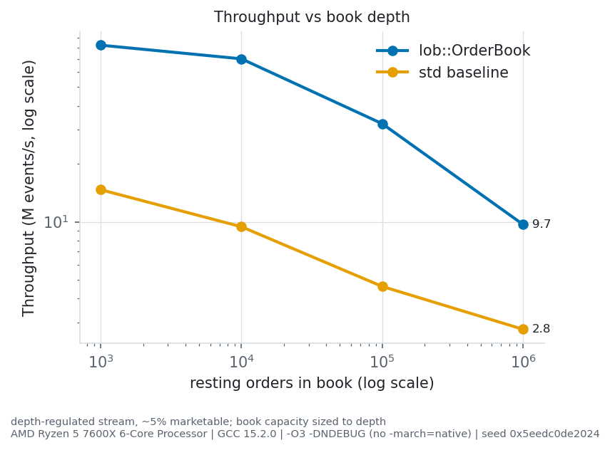

# Optimized Limit Order Book

A single-threaded C++17 limit order book with price-time priority, built around a
cache-friendly, allocation-free hot path. Header-only (`include/lob.hpp`), tested
against a reference book with a 1M-event randomized differential test under
ASan/UBSan, and benchmarked against a naive `std::map` + `std::list` +
`std::unordered_map` implementation.

**Headline (4M-event replay, 60% add / 35% cancel / 5% marketable):
37.3 M events/s vs 7.0 M events/s for the naive baseline (5.3x), with median
add/cancel latency of 70 ns / 50 ns.** Environment and caveats are listed below.

## Design

| Piece | Choice | Why |
|---|---|---|
| Price level | Intrusive doubly-linked FIFO (`PriceLevel`, `Order::prev/next`) | Insert at tail, remove from anywhere, pop from head: all O(1), no node allocation |
| Order storage | Fixed-capacity `OrderPool` with an intrusive free list | One allocation at construction; zero heap traffic per event |
| Price levels | `std::vector<PriceLevel>` per side, indexed by price tick | No tree walk: a level is one array index. Best bid/ask are cached |
| Order lookup | `FlatHashMap`: open addressing, linear probing, power-of-two table at load <= 0.5 | One or two cache lines per lookup; empty slot = null value |
| Deletion | **Backward-shift deletion** | Keeps probe chains intact without tombstones, so lookups never degrade |

Valid prices are the integer ticks `1 .. PriceRange-1` (`PriceRange` is a template
parameter, default 10000). Price 0 is the "no bid" sentinel and `PriceRange` the
"no ask" sentinel.

`add_order` returns an `AddResult { status, filled, rested }`. Orders are rejected
(and the book left untouched) for an out-of-range price, zero quantity, or an id
that is already resting. If the pool is full, matching still happens and the
unmatched remainder is dropped with `AddStatus::PoolExhausted`.

### Complexity

| Operation | Cost |
|---|---|
| `add_order`, no match | O(1) expected |
| `add_order`, matching | O(k) for k orders consumed, plus the best-price rescan below |
| `cancel_order` | O(1) expected, plus the best-price rescan below |
| `get_best_bid/ask`, `order_quantity` | O(1) |
| Best-price rescan (after the best level empties) | O(g), g = number of empty ticks to the next non-empty level; O(PriceRange) worst case |

The rescan is cheap while liquidity sits near the touch (the benchmark's case) but is
the honest worst case for very sparse books; a hierarchical bitmap would make it O(1).

## Build, test, benchmark

```bash
# tests (Release). On Windows/MinGW add: -G "MinGW Makefiles"
cmake -S . -B build -DCMAKE_BUILD_TYPE=Release
cmake --build build
ctest --test-dir build --output-on-failure        # or ./build/test_lob

# tests under AddressSanitizer + UndefinedBehaviorSanitizer (GCC/Clang)
cmake -S . -B build-san -DCMAKE_BUILD_TYPE=Debug -DLOB_SANITIZE=ON
cmake --build build-san --target test_lob && ./build-san/test_lob

# benchmark (always -O3) and figures
mkdir -p docs/results
./build/bench_lob --out docs/results       # add --quick for a ~10 s smoke run
python bench/plot.py                       # needs matplotlib
```


## Benchmark


Method: warm-up pass, then 7 timed passes with a fresh book each (median reported);
latency in a separate pass with per-event `lfence; rdtsc` / `rdtscp; lfence`; the
thread is pinned and the process set to high priority. Raw data is in
[`docs/results/`](docs/results): `throughput.csv`, `latency_summary.csv`,
`latency_cdf.csv` (quantile grid, not every sample), `depth_sweep.csv`,
`environment.csv`, `bench_stdout.txt`.

**Environment:** AMD Ryzen 5 7600X, Windows 11, GCC 15.2.0 (MSYS2/MinGW-w64), `-O3 -DNDEBUG`, no `-march=native`; TSC 4.69 GHz.

### Throughput (M events/s, median of 7)

| Book | Throughput | min – max |
|---|---|---|
| `lob::OrderBook` | **37.3** | 27.0 – 39.6 |
| std baseline | 7.0 | 6.8 – 7.2 |



### Latency per operation (ns)

| Op | Book | p50 | p99 | p99.9 |
|---|---|---|---|---|
| add (no fill) | `lob::OrderBook` | 70 | 351 | 521 |
| add (no fill) | std baseline | 120 | 371 | 631 |
| match (fills >0) | `lob::OrderBook` | 110 | 691 | 1533 |
| match (fills >0) | std baseline | 80 | 2455 | 5821 |
| cancel | `lob::OrderBook` | 50 | 401 | 671 |
| cancel | std baseline | 190 | 782 | 1413 |




### Throughput vs depth

| Resting orders | `lob::OrderBook` | std baseline | Speedup |
|---|---|---|---|
| 1,000 | 82.6 | 14.7 | 5.6x |
| 10,000 | 70.2 | 9.4 | 7.4x |
| 100,000 | 32.3 | 4.6 | 7.0x |
| 1,000,000 | 9.7 | 2.8 | 3.5x |



Throughput falls with depth for both books because the working set stops fitting in
cache (the 1M-order case touches ~50 MB of pool and hash table).

